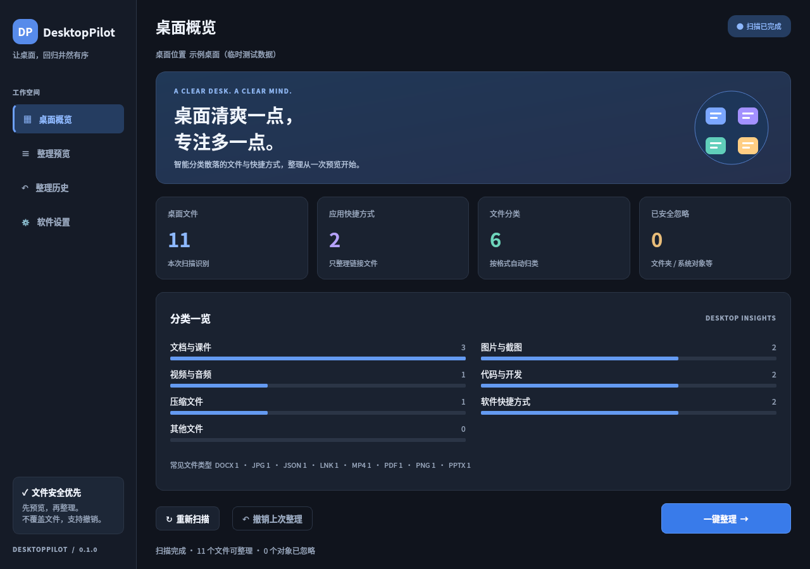
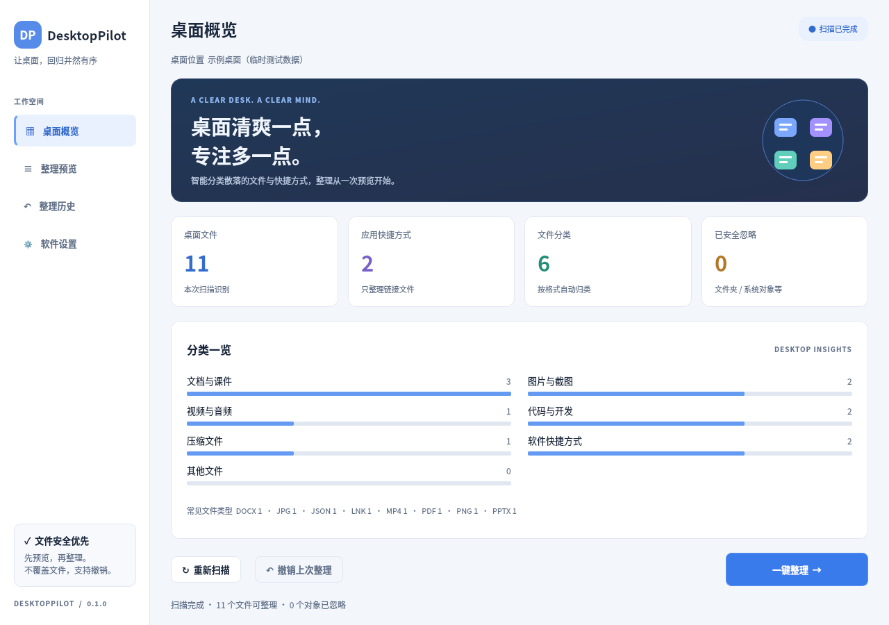

# DesktopPilot

**Windows 智能桌面整理助手** · Python 3.12 / PySide6

扫描桌面，预览分类结果，确认后整理，再按需撤销。DesktopPilot 将桌面上的普通文件和软件快捷方式归入 `DesktopPilot整理`，提供深色 / 浅色界面、统计仪表盘、分类预览、进度反馈、整理历史和本地设置。

> 当前版本为早期开发版本。建议首次使用前备份重要文件，并先在临时桌面目录中体验。程序不需要管理员权限，也不需要 API 密钥或云服务。

## 界面预览

以下为 Qt 离屏运行截图，展示临时测试数据。

| 深色主题 | 浅色主题 |
| --- | --- |
|  |  |

## 下载并运行 Windows exe

1. 打开本仓库的 **Actions → Build Windows executable**。
2. 选择一次成功完成的构建。推送到 `main` 会自动构建，也可点击 **Run workflow** 手动触发；Pull Request 也会运行测试和构建。
3. 在该次运行的 **Artifacts** 中下载 `DesktopPilot-Windows`（下载通常需要登录 GitHub）。
4. 解压下载的 zip，双击其中的 **DesktopPilot.exe**，无需另行安装 Python。

构建产物默认保留 30 天。尚未完成的构建不会提供 exe；本地源码和 CI 配置不代表已有发布产物。当前 exe 未做代码签名，Windows 可能显示 SmartScreen 提示；请确认下载来源，遵循所在组织的安全策略。目标系统为 Windows 10/11 64 位。

## 使用流程

1. **扫描桌面**：启动时获取 Windows 当前用户的真实桌面目录，支持 OneDrive 桌面重定向；也可手动重新扫描。仪表盘显示文件、类型和快捷方式统计。
2. **查看预览**：点击“一键整理”进入预览，逐项查看原位置、目标位置和类别。取消勾选的文件不会移动。
3. **确认整理**：只有再次确认后才执行移动。进度条展示执行情况，发生错误会显示原因，并保留已完成操作的历史。
4. **撤销整理**：点击撤销并确认，将上次可恢复的整理结果移回原位置。原位置已被占用或目标文件发生变化时会拒绝恢复，不覆盖已有文件。
5. **调整设置**：切换主题、自定义忽略规则，以及指定始终留在桌面的快捷方式。

### 分类目录

只处理桌面第一层的普通文件，不递归整理目录。文件按扩展名分类：

| 分类 | 常见内容 |
| --- | --- |
| 文档与课件 | Word、PDF、Excel、PowerPoint、文本等 |
| 图片与截图 | PNG、JPEG、GIF、WebP 等 |
| 视频与音频 | MP4、MKV、MP3、WAV 等 |
| 代码与开发 | Python、JavaScript、HTML、JSON 等 |
| 压缩文件 | ZIP、RAR、7z、TAR 等 |
| 软件快捷方式 | `.lnk`、`.url` |
| 其他文件 | 未匹配以上规则的普通文件 |

例如：`桌面/报告.pdf` → `桌面/DesktopPilot整理/文档与课件/报告.pdf`。扩展名匹配不区分大小写；只移动快捷方式文件，不解析或移动它指向的程序。

### 忽略与保留

- 默认跳过目录、隐藏 / 系统文件、`desktop.ini`、符号链接、Windows 重解析点（包括 junction）以及特殊文件对象。
- OneDrive 重定向的桌面路径由 Windows API 获取；带重解析属性的云占位文件会保守跳过，不会自动下载或强制移动。
- 跳过应用程序本体和安装程序（`.exe`、`.com`、`.msi`、`.msix`、`.msixbundle`、`.appx`、`.appxbundle`、`.dll`、`.sys`、`.scr`）；不递归进入 `DesktopPilot整理`。
- 自定义忽略列表支持通配符，例如 `重要*`、`*.tmp`；每行填写一条规则。
- 保留快捷方式列表填写快捷方式完整文件名，例如 `微信.lnk`、`工作门户.url`；每行一个。
- 重名时预览会给出带编号的可用目标名；执行时若该位置已被占用，会报告冲突，不覆盖文件。

## 从源码运行

安装 **Python 3.12** 后，在 PowerShell 中执行：

```powershell
git clone https://github.com/ViIiOleTe/DesktopPilot-Windows-desktop-smart-organizer.git
cd DesktopPilot-Windows-desktop-smart-organizer
py -3.12 -m venv .venv
.\.venv\Scripts\python -m pip install -r requirements-dev.txt
.\.venv\Scripts\python -m desktop_pilot
```

仅运行应用也可安装 `requirements.txt`；在仓库根目录执行 `python -m desktop_pilot`。开发安装还会注册 `desktop-pilot` 命令。

运行测试：

```powershell
$env:QT_QPA_PLATFORM = "offscreen"
.\.venv\Scripts\python -m pytest -q
```

所有自动化文件操作测试均使用临时目录，不读写真实桌面。CI 在运行 pytest 后生成 exe，再离屏启动打包后的 exe：使用临时目录验证整理与撤销、校验文件内容并创建窗口，确认成功后才上传产物。Windows Runner 运行原生文件移动、隐藏 / 系统属性和 junction 测试；桌面路径 API 的成功、失败及内存释放采用模拟测试。Linux 可验证跨平台核心与 Qt 离屏界面，无法据此确认真实 Windows / OneDrive 桌面集成和 exe 运行正常。

Linux 开发检查：

```bash
python3.12 -m venv .venv
.venv/bin/python -m pip install -r requirements-dev.txt
QT_QPA_PLATFORM=offscreen .venv/bin/python -m pytest -q
```

Qt 离屏模式是测试用途；实际桌面界面需要图形会话。Linux 的 `~/Desktop` 仅作为开发环境回退路径，不提供 Windows 桌面整理体验。

不接触真实桌面的完整诊断（Qt 窗口、临时文件扫描、整理和撤销）：

```bash
.venv/bin/python -m desktop_pilot --smoke-test /tmp/desktoppilot-smoke.json
```

退出码为 0 且报告的 `status` 为 `ok` 表示诊断通过；Windows exe 同样支持 `DesktopPilot.exe --smoke-test <报告路径>`。

## Windows 打包

在 Windows 上运行以下命令，输出为 `dist/DesktopPilot.exe`：

```powershell
.\.venv\Scripts\python -m PyInstaller --noconfirm --clean DesktopPilot.spec
```

PyInstaller 不能从 Linux 交叉生成 Windows exe，请使用 Windows 本机或仓库提供的 GitHub Actions。单文件 exe 首次启动会将 Qt 运行库解压到临时目录，启动速度可能稍慢。

## 数据与安全边界

设置与整理历史分别以 `settings.json` 和 `history.json` 保存在用户本地应用数据目录（Windows 为 `%LOCALAPPDATA%\DesktopPilot`）；Linux 为 `$XDG_CONFIG_HOME/DesktopPilot`，未设置时使用 `~/.config/DesktopPilot`。移动记录包含完整文件路径，请妥善保管本地历史。删除历史会失去对应的撤销依据。

- 默认不删除用户文件，也不清空分类文件夹；撤销只移动文件，不替用户清理目录。
- 文件移动前再次校验预览来源和目标，拒绝越出桌面 / 分类目录的请求，避免旧预览误操作。
- 历史记录用于恢复已记录的移动；备份、杀毒软件、同步客户端和第三方程序同时改动文件，仍可能使某些项目无法撤销。请先停止这些冲突操作，再查看错误并重试。
- 整理不是多文件原子事务：某个文件失败时，其他已成功的移动保留并可撤销。请查看完成摘要和历史。
- 不扫描目录内容，不识别快捷方式目标的应用类型，不内置 AI 模型，不上传文件。
- 只整理当前用户桌面，不处理公共桌面或回收站等 Windows 虚拟图标。

## 项目结构

```text
desktop_pilot/
  __main__.py       # Qt 入口
  core.py           # 扫描、分类、预览、整理和撤销
  storage.py        # 本地设置与历史存储
  windows.py        # Windows 桌面目录解析
  gui.py            # 仪表盘、预览、历史与设置界面
tests/              # 临时目录与离屏界面测试
DesktopPilot.spec   # PyInstaller 单文件构建
.github/workflows/build-windows.yml
```
