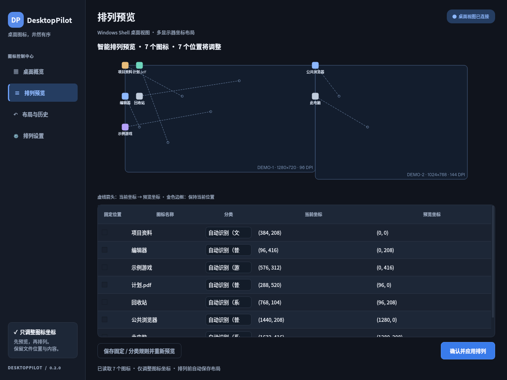

# DesktopPilot

**Windows 桌面图标智能排列助手** · Python 3.12 / PySide6 / Windows Shell COM

DesktopPilot 读取资源管理器桌面上实际显示的图标，按“文件夹、普通软件、游戏、普通文件、系统图标”规划排列区域，展示前后坐标预览，确认后调整图标位置。支持深色 / 浅色界面、分类顺序、横向 / 纵向排列、分组间隔、固定图标、保存布局与撤销。

本版本只修改图标坐标。文件与文件夹的磁盘路径、内容、名称均保持不变；不创建分类文件夹，不搬移文件，不删除文件，也不启动快捷方式目标。旧版本的文件归档行为已移除。

## 界面预览

以下截图由模拟图标数据生成，展示 Qt 界面，不代表真实 Windows Shell 排列验收。

| 控制中心 | 坐标排列预览 |
| --- | --- |
|  |  |

## 下载 Windows exe

1. 打开仓库的 **Actions → Build Windows executable**，选择一次成功完成的构建。
2. 在该次运行的 **Artifacts** 中下载 `DesktopPilot-Windows`（通常需要登录 GitHub）。
3. 解压 zip，运行 **DesktopPilot.exe**，无需安装 Python 或 Visual Studio。

推送到 `main`、面向 `main` 的 Pull Request 和手动 **Run workflow** 均可触发构建。产物默认保留 30 天。当前 exe 未做代码签名，Windows 可能显示 SmartScreen 提示；请核对下载来源并遵循所在组织的安全策略。目标系统为 Windows 10/11 x64。

## 使用流程

1. **关闭自动排列**：在 Windows 桌面空白处右键 → **查看**，取消勾选 **自动排列图标**。DesktopPilot 检测到该选项开启时会阻止应用布局，并给出操作提示；不会替用户更改此系统设置。
2. **扫描实际桌面**：获取 Explorer 当前显示的图标与坐标，包括当前用户桌面、公共桌面，以及回收站等 Shell 虚拟图标。OneDrive 重定向由 Explorer 自身处理。
3. **设置分类与布局**：调整分类顺序、排列方向和类别间隔，选择固定图标；固定图标保留当前位置。
4. **检查预览**：查看图标类别、原坐标和目标坐标，确认空间与位置符合预期，再执行排列。扫描和预览不改变图标坐标。
5. **保存与恢复**：可保存当前布局，之后预览恢复；应用任何布局前都会记录原始坐标。撤销恢复最近一次排列前的位置。

图标过多、可用工作区域不足、显示器布局变化或某些图标无法读取时，程序会提示问题；请检查预览与执行摘要。排列按网格规划，不承诺每种桌面缩放、第三方桌面替代程序或远程会话均呈现相同视觉结果。

### 分类规则

| 分类 | 判定依据 |
| --- | --- |
| 文件夹 | Shell 提供的文件夹属性 |
| 普通软件 | 应用快捷方式或程序图标；不确定的快捷方式保守归入普通软件 |
| 游戏 | 快捷方式目标 / 参数命中可配置游戏规则，如 Steam、Epic Games |
| 普通文件 | 其余文件系统项目 |
| 系统图标 | 回收站等非文件系统 Shell 项目 |

游戏识别不依赖联网或 AI；无法仅凭快捷方式准确识别所有游戏，用户可添加规则或覆盖单个图标类别。规则与忽略列表支持通配符。读取 `.lnk` 元数据时不调用 `IShellLink::Resolve`，也不会打开、启动或访问目标程序；`.url` 只读取其已存储的目标信息。

### 稳定标识与恢复

恢复依据图标稳定标识，而非列表行号或显示名称：文件系统项目使用卷、文件 ID 与创建时间，降低删除后文件 ID 被重用导致误匹配的风险；虚拟项目使用规范 Shell 解析标识。文件重命名后通常仍可对应原图标；删除后以同名新建的项目不会仅凭名称恢复。

布局还记录显示器工作区域、图标间距等环境信息。显示器移除、分辨率 / DPI 改变或图标已不存在时，应先查看恢复预览和提示，避免将图标放到不可见区域。Explorer 重启、第三方程序或用户同时拖动图标也可能使旧预览失效，请重新扫描。

## 从源码运行

需要 **Windows 10/11 x64、Python 3.12 x64、Visual Studio 2022 Build Tools**。安装 Build Tools 时勾选 **使用 C++ 的桌面开发**，包含 MSVC x64 工具链和 Windows 10/11 SDK。

在 **x64 Native Tools Command Prompt for VS 2022** 中执行：

```bat
git clone https://github.com/ViIiOleTe/DesktopPilot-Windows-desktop-smart-organizer.git
cd DesktopPilot-Windows-desktop-smart-organizer
py -3.12 -m venv .venv
.venv\Scripts\python -m pip install -r requirements-dev.txt
tools\build_native.cmd
.venv\Scripts\python -m desktop_pilot
```

`tools\build_native.cmd` 使用 Windows SDK 编译 `native/desktop_shell.cpp`，输出 `desktop_pilot/native/desktop_shell.dll`；中间文件位于 `build/native`。仅运行已有源码时可安装 `requirements.txt`，但仍需先构建 DLL。应用无需管理员权限、API 密钥或第三方 Python COM 包。

### Windows 原生桥接

Python 通过 `ctypes` 调用项目自带的 C++ DLL。DLL 使用 Windows SDK 定义的 COM 接口连接 Explorer 桌面视图，并通过以下受支持接口操作：

- `IFolderView::Items`：枚举当前桌面视图中的项目。
- `IFolderView::GetItemPosition`、`GetSpacing`：读取图标位置与网格间距。
- `IFolderView::SelectAndPositionItems`：设置选定图标的坐标。

桥接层只读取项目元数据和调整桌面坐标，不调用文件移动、重命名、删除或启动 API。桌面视图暂不可用时会报错，不能用磁盘目录枚举冒充实际桌面视图。该机制依赖正在运行的 Windows Explorer 与交互式桌面会话。

坐标使用 Explorer 桌面视图的客户端坐标系。显示器工作区通过 `MapWindowPoints` 映射到同一空间，桥接线程匹配 Explorer 的 DPI 上下文；Qt 只缩放预览画布，不对实际坐标再次乘以 DPI 比例。

微软接口参考：[IFolderView](https://learn.microsoft.com/en-us/windows/win32/api/shobjidl_core/nn-shobjidl_core-ifolderview)、[SelectAndPositionItems](https://learn.microsoft.com/en-us/windows/win32/api/shobjidl_core/nf-shobjidl_core-ifolderview-selectandpositionitems)、[GetAutoArrange](https://learn.microsoft.com/en-us/windows/win32/api/shobjidl_core/nf-shobjidl_core-ifolderview-getautoarrange)。

## 测试与 CI

Windows 本地自动化检查：

```bat
tools\build_native.cmd
set QT_QPA_PLATFORM=offscreen
.venv\Scripts\python -m pytest -q
.venv\Scripts\python -m desktop_pilot --smoke-test "%TEMP%\desktoppilot-smoke.json"
```

所有自动化测试使用模拟桌面后端和临时 JSON 数据目录，不读取真实桌面，也不移动真实图标。Windows 检查可验证 DLL 被加载、导出函数存在；不会调用真实 Explorer 枚举或定位接口。退出码为 0 且诊断 JSON 的 `status` 为 `ok` 表示模拟自检通过。

CI 使用 `windows-latest` 与 Python 3.12：安装依赖 → 初始化 MSVC x64 → 构建原生 DLL → pytest → PyInstaller → 启动 exe 的模拟后端自检 → 上传产物。打包自检验证 Qt、模拟布局与持久化，以及 Windows DLL 加载和导出，不代表真实 Explorer COM 行为或可见图标坐标已获验证。

Linux 云环境可以检查布局、分类、存储和 Qt 离屏界面：

```bash
python3.12 -m venv .venv
.venv/bin/python -m pip install -r requirements-dev.txt
QT_QPA_PLATFORM=offscreen .venv/bin/python -m pytest -q
.venv/bin/python -m desktop_pilot --smoke-test /tmp/desktoppilot-smoke.json
```

Linux 没有 Explorer 桌面视图，也不能交叉生成 Windows DLL / exe。Linux 构建只能用于模拟后端诊断，不能整理 Windows 图标。

## Windows exe 打包

在 x64 VS 2022 开发者命令行中运行：

```bat
tools\build_native.cmd
.venv\Scripts\python -m PyInstaller --noconfirm --clean DesktopPilot.spec
```

输出为 `dist/DesktopPilot.exe`。Windows 构建缺少 `desktop_shell.dll` 时会立即失败；spec 将 DLL、Qt 依赖和图标资源一起打包。单文件程序首次启动需要解压运行库，启动可能稍慢。

## 本地数据

Windows 数据目录为 `%LOCALAPPDATA%\DesktopPilot`；Linux 模拟开发使用 `$XDG_CONFIG_HOME/DesktopPilot`，未设置时为 `~/.config/DesktopPilot`。

- `icon-settings.json`：主题、分类规则、排列选项、固定图标等设置。
- `icon-layouts.json`：已保存布局和排列前坐标快照，供恢复与撤销。

布局含图标名称、稳定标识和坐标，请按本地隐私数据保管。损坏 JSON 不会被静默覆盖。旧版 `settings.json` / `history.json` 保留原样，本版本不将文件移动历史转换为坐标布局，也不执行旧版文件撤销。

## 手工 Windows 10/11 验收

真实桌面集成需要在交互式 Windows 会话中单独确认。建议先记录当前桌面，再按以下清单验收；CI 不会执行这些操作。

- 自动排列开启时应阻止执行；关闭后可以扫描、预览并排列。
- 检查当前用户、公共桌面、回收站等实际显示项目都能被正确识别；确认扫描坐标与可见图标相符。
- 排列前后对比文件路径、名称、内容与目录结构，确认均保持不变。
- 执行布局后检查可见坐标、类别顺序、类别间隔、横向 / 纵向规则和固定图标。
- 验证撤销、保存布局再恢复；重命名图标后仍能识别，删除图标后应跳过并提示，同名新图标不能误恢复。
- 验证双显示器、移除显示器、负坐标、不同缩放比例与 DPI、改变分辨率后的恢复提示和可见范围。
- 使用足够多的图标验证空间不足提示；检查不会重叠固定位置或悄悄漏排。
- 单独验证“将图标与网格对齐”开启的情况。微软没有提供受支持的网格原点查询；若 Explorer 将请求坐标吸附为不同位置，程序会提示回读不一致并保留原快照供恢复，不会静默声称成功。
- 验证 Explorer 重启和手工拖动导致旧预览失效的情况；错误后可重新扫描，不启动任何快捷方式目标。

## 项目结构

```text
native/desktop_shell.cpp       # Windows SDK COM 桌面视图桥接
工具链 → desktop_pilot/native/desktop_shell.dll
desktop_pilot/
  __main__.py                 # Qt / 模拟自检入口
  models.py                   # 图标、坐标、显示器和布局模型
  core.py                     # 分类、网格规划、恢复与撤销
  storage.py                  # 原子 JSON 设置与布局存储
  windows.py                  # ctypes 原生桥接适配器
  gui.py                      # 仪表盘、布局预览、历史和设置
  smoke.py                    # 不触碰真实桌面的模拟诊断
tests/                        # 临时数据与模拟后端测试
tools/build_native.cmd        # MSVC x64 DLL 构建
DesktopPilot.spec             # PyInstaller 单文件 exe
.github/workflows/build-windows.yml
```
